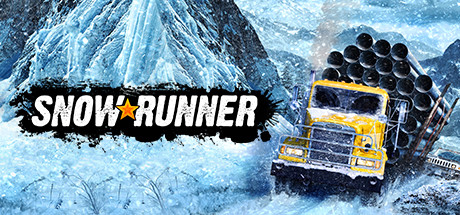

**SnowRunner is the brutally realistic off-road truck simulator where you recover vehicles, deliver cargo, and complete contracts across mud, snow, and flooded terrain using a diverse lineup of American and Russian trucks and their add-ons.**

---

## 📖 About

SnowRunner is the brutally realistic off-road truck simulator where you recover vehicles, deliver cargo, and complete contracts across mud, snow, and flooded terrain using a diverse lineup of American and Russian trucks and their add-ons.

## ⚠️ Problems Without Trainer

| Problem | Status |
|---------|--------|
| **Truck Recovery** — Getting stuck in deep mud without a winch anchor point creates difficult situations | ✅ Solved |
| **Fuel Management** — Running out of fuel far from a station in harsh terrain is mission-ending | ✅ Solved |
| **Task Ordering** — Attempting contracts before unlocking required equipment creates impossible situations | ✅ Solved |
| **Map Exploration** — Many contracts require discovering locations without prior map knowledge | ✅ Solved |

## ✅ Solution

The **SnowRunner Trainer** solves all these issues by giving you complete control over the game.

## 🎯 Full Feature List

- Unlimited Resources
- God Mode / Invincibility
- Instant Skill Cooldown
- One-Hit Kill
- Freeze Game Timer
- Unlock All Items & Achievements
- Custom Speed Multiplier
- Save State Anywhere

## 🚀 Quick Start

1. **Disable Windows Defender** temporarily (trainer may trigger false positive)
2. Download the trainer from the button above
3. Launch SnowRunner
4. Run the trainer as Administrator
5. Activate desired cheats with hotkeys

## 💎 Free vs Paid

| Feature | Free | Pro |
|---------|------|-----|
| Basic God Mode | ✅ | ✅ |
| Unlimited Resources | ✅ | ✅ |
| All Advanced Cheats | ❌ | ✅ |
| Auto-Updates | ❌ | ✅ |
| Priority Support | ❌ | ✅ |

## 💻 Requirements

- Windows 10/11 (64-bit)
- SnowRunner (any version)
- .NET Framework 4.8+
- DirectX 11+

## 🍎 macOS

macOS users can use our alternative tool:

## ⚖️ Legal

This trainer is for educational and single-player use only. Use responsibly.

---

